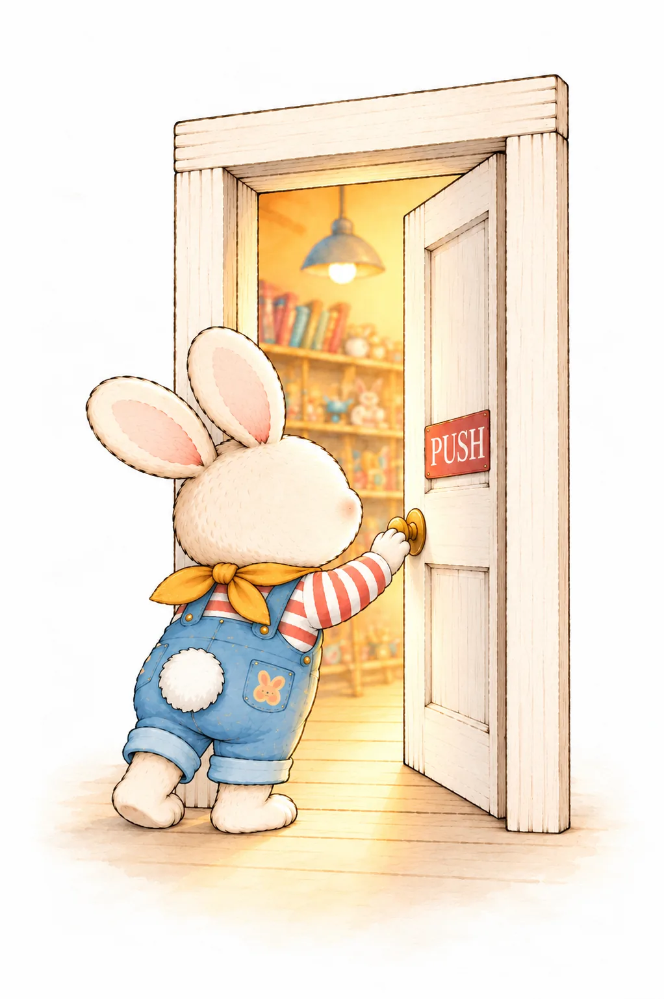

# Why the Door Says Push

**A book about design for adults, kids and product owners.**

📖 **Read it here: [mckievska-ship-it.github.io/why-the-door-says-push](https://mckievska-ship-it.github.io/why-the-door-says-push/)**

  

Why the Door Says Push is a free, illustrated web book that explains 70 UX design principles through tiny tales about Pip, a bunny who runs a toy shop and learns to make it better for his friends.

Each page pairs one principle with a short story and a watercolor illustration. A kid can follow the story, a product owner can see the "why" behind a design decision, and a designer can enjoy familiar rules in a new light.

## What's inside

| Chapter | Principles |
| --- | --- |
| 1. How our brains see | Visual hierarchy, Gestalt, Fitts's Law, Hick's Law, Jakob's Law, affordances, feedback and more |
| 2. People (and bunnies) | User flows, task flows, journey maps, service blueprints, personas, Jobs to Be Done |
| 3. Trying things out | Usability testing, A/B testing, heuristic evaluation, card sorting, tree testing |
| 4. Room for everyone | Accessibility, WCAG, color contrast, semantic HTML, screen readers, keyboard navigation |
| 5. Every screen size | Responsive, adaptive and mobile-first design |
| 6. Building blocks | Design tokens, component libraries, design systems, atomic design, variants |
| 7. Little moments | Microinteractions, motion, empty, error and loading states, edge cases |
| 8. Growing the shop | Conversion, North Star metric, activation, retention, churn, acquisition, revenue |
| 9. Working together | Design critique, developer handoff |

## How to read

- **Desktop:** click the right side of the book to turn forward, the left side to go back, or swipe on your trackpad. Arrow keys work too.
- **Phone:** one page at a time; swipe to turn.
- **Jump around:** tap a chapter on the contents page, or type a page number (1–70) under the book.

## How it was made

This book is an experiment in designing with AI.

- **Tales** were written together with [Claude](https://claude.ai), which also helped build the book.
- **Illustrations** began in Midjourney and ChatGPT and were refined page by page.
- **Layout** was designed in Figma and built as a single web page using [StPageFlip](https://github.com/Nodlik/StPageFlip) for the page turning.
- **Type** is set in [Amatic SC](https://fonts.google.com/specimen/Amatic+SC) and [Schoolbell](https://fonts.google.com/specimen/Schoolbell).
- **Paper texture** by [Nordwood Themes](https://unsplash.com/@nordwood) on Unsplash.

## Sources

Pip learned these principles from Jon Yablonski's *Laws of UX*, Don Norman's *The Design of Everyday Things*, Steve Krug's *Don't Make Me Think*, Nielsen Norman Group, the W3C's WCAG, Brad Frost's *Atomic Design*, Clayton M. Christensen's *Competing Against Luck*, Sean Ellis and Morgan Brown's *Hacking Growth*, and the Interaction Design Foundation.

## Author

Made by **Anna Makiievska**, product designer.
[makiievska.design](https://makiievska.design) · [LinkedIn](https://www.linkedin.com/in/mckievska)

---

© 2026 Anna Makiievska. Text and illustrations are free to read and share with a link to this book; please don't reuse them without permission.
